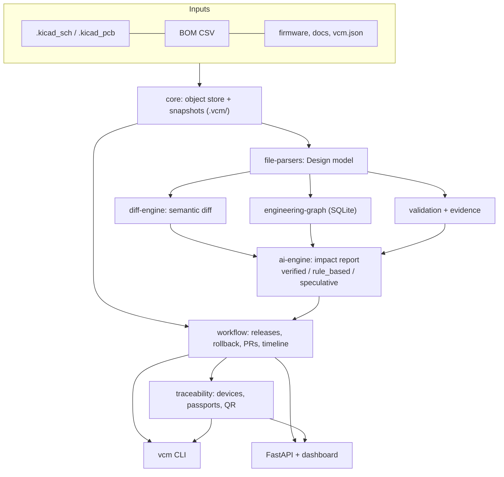

# VCM Hardware

**Every hardware revision has a story. VCM makes it traceable.**

VCM ("Version Control for Hardware") is an engineering-aware version-control and intelligence layer that sits above Git
(or runs standalone) for hardware projects. It is built around three questions:

1. **What exactly changed in this revision?** A semantic diff of BOM, PCB footprints, placement and net connectivity, not just changed bytes.
2. **What else could that change affect, and what evidence supports it?** A dependency graph plus an offline impact report whose findings are labelled `verified`, `rule_based` or `speculative`, each with evidence links.
3. **Which physical devices were built from the affected configuration?** Releases pin artifact hashes; devices are registered against releases and can be looked up by component or revision.

> **Status: working MVP, honest scope.** PCB (KiCad) and BOM first. Everything marked *Implemented* below runs and is covered by tests in this repository. Everything marked *Planned* does not exist yet. See [Limitations](#limitations).

## Modules: implemented vs planned

| # | Module | Location | Status |
|---|--------|----------|--------|
| 1 | Content-addressed object store, snapshots, branches, tags, commit/log/checkout/diff, evidence store | `packages/core` | **Implemented** (local, single-user; no merge, no remotes) |
| 2 | File parsers: KiCad `.kicad_sch` / `.kicad_pcb` (own S-expression parser), BOM CSV | `packages/file-parsers` | **Implemented** for KiCad 6-9 style files and BOM CSV. Schematic wires are not traced: net connectivity comes from PCB pad assignments. No Altium/Eagle/other formats |
| 3 | Semantic diff engine | `packages/diff-engine` | **Implemented** for BOM, footprints, placement, nets. No mechanical, FPGA or firmware-source semantic diff |
| 4 | Engineering dependency graph | `services/engineering-graph` | **Implemented** in SQLite. PostgreSQL is the intended production backend (not built) |
| 5 | Impact analysis ("AI engine") | `services/ai-engine` | **Implemented** as a deterministic rule engine over a small JSON component DB. LLM provider interface exists with a no-op default; no real LLM provider ships |
| 6 | Validation | `services/validation` | **Implemented**: built-in checks plus an optional `kicad-cli` DRC/ERC wrapper (skipped when `kicad-cli` is absent; the wrapper has not been exercised against a real KiCad install here) |
| 7 | Release manifests, verification, rollback planner | `packages/workflow` | **Implemented** (JSON/YAML manifest, tamper detection by re-hashing) |
| 8 | Physical traceability: device registry, passports, QR | `services/traceability` | **Implemented** with a local JSON registry and a pure-Python QR encoder (byte mode, level M, versions 1-10) |
| 9 | Hardware pull requests | `packages/workflow` | **Partial**: local review record (diff, impact, validation, comments, approvals). No merge action, identity or permissions |
| 10 | Hardware Time Machine (`timeline`, `explain`) | `packages/workflow` | **Implemented** |
| 11 | CLI, REST API, static dashboard | `packages/vcm-cli`, `services/api` | **Implemented** (no authentication; intended for local/trusted use) |
| 12 | Integrations and apps: KiCad plugin, FreeCAD, Git bridge, web app, desktop app | `integrations/`, `apps/` | **Planned**: README stubs only |
| - | GPU Git for GPUOS / VACE | [`docs/gpu-git.md`](docs/gpu-git.md) | **Planned**: scope document only, nothing implemented |

## Architecture



```
 files ──► core (sha256 objects, revisions) ──► parsers (Design) ──┬─► diff ──────┐
                                                                   ├─► graph ─────┼─► ai-engine ─► report (JSON/MD)
                                                                   └─► validation ┘        │
 releases ◄── workflow ◄───────────────────────────────────────────────────────────────────┘
    └──► devices / passports / QR ──► CLI (vcm) and REST API + dashboard
```

More detail in [`docs/architecture.md`](docs/architecture.md) and [`docs/data-model.md`](docs/data-model.md).

## Quickstart

Requires Python 3.11+. The core has no third-party dependencies; the API and tests need FastAPI and httpx.

```bash
python3 -m venv .venv && . .venv/bin/activate
make install          # pip install -e ".[dev]"
make test             # pytest
make demo             # end-to-end demo
```

Using the CLI on your own project folder:

```bash
vcm init .
vcm commit -m "rev A" --tag revA        # snapshot every file, categorised by type
# ...edit files...
vcm commit -m "rev B" --tag revB
vcm diff revA revB                      # semantic diff
vcm impact revA revB                    # Markdown impact report (use --json for JSON)
vcm validate --rev revB --compare revA  # built-in checks, stored as evidence
vcm release create R1 --rev revB        # pin hashes
vcm release verify R1
vcm device register SN-0001 --release R1 --batch B1   # writes a QR SVG
vcm device affected --component U1 --value AMS1117-3.3
vcm rollback plan revA --from revB
vcm timeline ; vcm explain revA revB
vcm graph query --component U1
```

REST API and dashboard:

```bash
pip install -e ".[api]"
VCM_REPO=/path/to/project uvicorn vcm_api.app:app
# dashboard at http://127.0.0.1:8000/   API docs at /docs
```

To enable project-specific knowledge, commit a `vcm.json` next to your design (see `examples/sample-pcb/v1.1/vcm.json`): rails, firmware links (`configured_by`), tests (`validated_by`) and external loads.

## Demo walkthrough

`examples/demo.sh` commits two revisions of the sample ESP32-C3 sensor node and runs the whole flow. v1.1 swaps the AMS1117-3.3 LDO (SOT-223, 1 A) for an MCP1700-3302E/TT (SOT-23, 250 mA) and changes the output capacitor from 22 uF tantalum to 10 uF ceramic.

1. **Diff**: `U1` and `C2` replaced, both footprints changed, `C2` and `R1` moved. Nets are unchanged.
2. **Impact** (12 verified, 4 rule-based, 3 speculative findings):
   - *verified*: the replacements, footprint changes (PCB layout must change), shared nets with 9 components, firmware linked to `U2` through `vcm.json`, tests to re-run.
   - *rule_based*: `U1` cannot supply the peak load on `+3V3` (about 375 mA peak vs 250 mA rating, critical), junction temperature estimate over limit at peak load, firmware brownout setting to review, pinout consistent.
   - *speculative*: radio bursts may brown out units, enclosure heating, ripple change from tantalum to ceramic.
3. **Validation, release, verify**: built-in checks pass on both revisions; two release manifests are written and verified.
4. **Devices**: three devices are registered (two on R1.0, one on R1.1) with QR SVGs; `device affected --component U1 --value AMS1117-3.3` returns the two older units; `--revision v1.1` returns the newer one.
5. **Rollback plan** v1.1 to v1.0: not software-reversible, board respin required because the footprints differ.
6. **Tamper check**: a pinned firmware blob is modified and `release verify` fails as expected.

The numbers come from the small illustrative component DB in `services/ai-engine/vcm_ai/data/components.json`. They demonstrate the mechanism; they are not a substitute for datasheet review.

## Confidence classes

Every impact finding has exactly one `confidence_class`, plus evidence links (`file` with hash, `ref`, `commit`):

- `verified`: derived from parsed design data, declared project links or stored evidence.
- `rule_based`: heuristic warning from engineering rules and the component DB.
- `speculative`: a prediction; not established by data.

An optional LLM provider can only add `speculative` findings. The default provider is a no-op and VCM never calls the network by default.

## Competitor landscape

The tools below are real and mature in their areas. This table is a high-level orientation from public positioning, not a feature audit; check each vendor for current capabilities.

| Tool | What it is good at | Where VCM differs |
|------|--------------------|-------------------|
| Altium 365 | Cloud-hosted ECAD collaboration, versioning and review for Altium designs, tight integration with the Altium editor | VCM is open, local-first, KiCad/BOM based, and focuses on cross-artifact impact and device lineage rather than ECAD authoring |
| Autodesk Fusion (with Fusion Manage / Vault-style data management) | Integrated MCAD + ECAD + PLM in one vendor ecosystem | VCM is vendor-neutral and file-based; it does not do CAD, simulation or PLM workflows |
| Onshape | Cloud-native MCAD with built-in branching, merging and release management | VCM does not version native CAD models semantically; Onshape is far ahead for mechanical |
| Git LFS | Stores large binaries next to Git history | Storage only: no parsing, semantic diff, impact or traceability. VCM's store is also content-addressed and large-file friendly but adds the engineering layer |
| OpenBOM | Cloud BOM management, part catalogs and sourcing | VCM's BOM handling is diff/validation-oriented and local; it has no catalog, sourcing or costing |
| AllSpice | Git-based collaboration with design-aware diffs for ECAD files | Closest in spirit for review. VCM's intended differentiator is the combination, in one offline tool, of semantic diff, graph-based impact with explicit confidence classes, hash-pinned releases and per-device traceability (passports, QR, affected-device lookup) |

**The integrated differentiator, stated honestly:** none of the individual ideas is unique. VCM's bet is that diff, impact reasoning, validation evidence, release pinning and physical-device lineage should live in one auditable model. Today that model is a small, local MVP: single user, KiCad and BOM only, a deliberately tiny component knowledge base, no hosted collaboration, and no ECAD/MCAD authoring.

## Limitations

- KiCad and BOM CSV only. No Altium, Eagle, OrCAD, STEP/mechanical, FPGA or HDL semantic parsing; those files are stored and categorised but not interpreted.
- Schematic connectivity (wires, labels, hierarchy) is not traced; nets are read from PCB pad assignments. The sample KiCad files are hand-generated and have not been opened in KiCad.
- The component property DB has four parts. Rules are heuristics (current headroom, dropout, thermal estimate, output-capacitor ESR, pinout consistency, rating derating) and can be wrong or incomplete.
- Single-user local repositories: no remotes, merge, locking, authentication or permissions. Revision history is first-parent only.
- Release verification detects accidental or naive tampering by re-hashing; there are no signatures, so someone who can rewrite both manifest and store can forge a release. Signing is planned.
- The REST API has no authentication and is meant for localhost or trusted networks.
- `kicad-cli` integration is untested against a real install in this repository's CI.
- GPU Git, KiCad/FreeCAD plugins, the web app and the desktop app are not implemented.

## Repository map

```
packages/core            object store, snapshots, repository      (vcm_core)
packages/file-parsers    KiCad S-expression + BOM parsers          (vcm_parsers)
packages/diff-engine     semantic hardware diff                    (vcm_diff)
packages/workflow        releases, rollback, PRs, timeline         (vcm_workflow)
packages/vcm-cli         `vcm` command                             (vcm_cli)
services/engineering-graph  SQLite dependency graph                (vcm_graph)
services/ai-engine       offline impact analysis                   (vcm_ai)
services/validation      checks, kicad-cli wrapper, evidence       (vcm_validation)
services/traceability    devices, passports, QR                    (vcm_trace)
services/api             FastAPI app + static dashboard            (vcm_api)
examples/                sample KiCad project and demo.sh
integrations/, apps/     documented placeholders (not implemented)
docs/                    architecture, data model, roadmap, GPU Git scope
```

Licensed under Apache-2.0. See [CONTRIBUTING.md](CONTRIBUTING.md).
